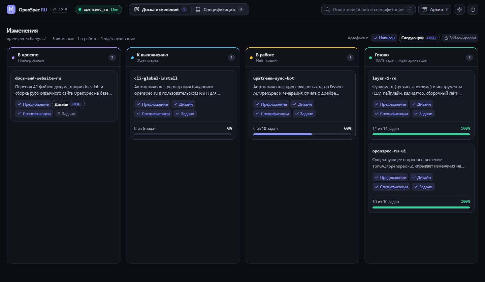
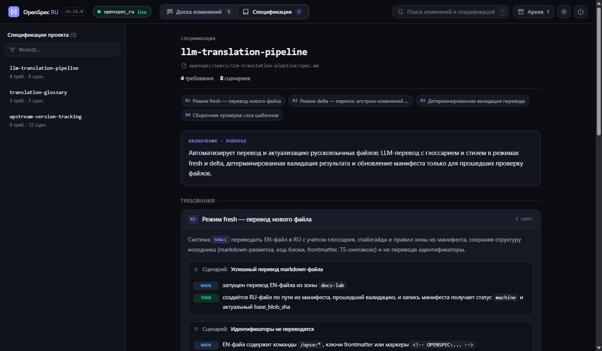

# openspec_ru

Русскоязычный перевод [OpenSpec](https://github.com/Fission-AI/OpenSpec) — AI-скиллов, slash-команд, схем артефактов и встроенной веб-панели спецификаций, — привязанный к конкретной версии оригинала (`v1.15.0`), с автоматическим обнаружением дрейфа апстрима.

<p align="center">
  
</p>
<p align="center">
  
</p>

## Быстрый старт для пользователей

Работает на **Windows, macOS и Linux**. При первом запуске через `npx` утилита автоматически устанавливает команду `openspec-ru` в ваш пользовательский `PATH` (`~/.openspec-ru/runtime`), поэтому дальше можно вызывать `openspec-ru` напрямую без `npx`.

### 1. Инициализация нового проекта сразу на русском (в один шаг)

В корне вашего Git-репозитория (если `.git` отсутствует, команда заблокирует выполнение):

```sh
# 1. Установите штатный CLI OpenSpec один раз на компьютер (если ещё не установлен)
npm install -g @fission-ai/openspec@latest

# 2. Инициализируйте проект и сразу примените русский перевод одной командой
npx --yes github:OnePro/openspec_ru init
# или неинтерактивно (например, для Claude Code, Cursor, Pi или всех инструментов):
npx --yes github:OnePro/openspec_ru init --tools claude
```

Что делает команда за один шаг:
- проверяет наличие `.git` в папке;
- запускает штатный `openspec init`;
- переводит созданные `SKILL.md` и slash-команды всех выбранных инструментов на русский язык;
- устанавливает русскую схему `openspec/schemas/spec-driven/` и языковой контекст `Language: Russian` в `openspec/config.yaml`;
- добавляет бонусный скилл **`openspec-ui`** (чтобы можно было сказать агенту в чате *«открой спеки»*) и прописывает команду `openspec-ru` в `PATH`.

### 2. Перевод уже существующего проекта (`apply`)

Если `openspec init` в проекте уже выполнялся ранее:

```sh
npx --yes github:OnePro/openspec_ru apply
# или, если openspec-ru уже установлен:
openspec-ru apply
```

Для предпросмотра без записи на диск используйте `--dry-run`:

```sh
openspec-ru apply --dry-run
```

### 3. Обновление до новой версии (`update`)

Когда выходит новая версия `openspec_ru` или обновляется сам CLI `@fission-ai/openspec` / список инструментов в проекте, выполните в корне репозитория:

```sh
openspec-ru update
# или через npx (с обходом локального кэша npx):
npx --yes github:OnePro/openspec_ru#HEAD update
```

Команда сама:
1. запускает штатный `openspec update` (подтягивая новые воркфлоу профиля и инструменты);
2. скачивает свежий бандл `openspec_ru` напрямую с GitHub в `~/.openspec-ru/runtime`;
3. накатывает русские версии всех скиллов, команд и схем поверх.

### 4. Веб-панель изменений и спецификаций (`start web` / «открой спеки»)

В корне любого репозитория с папкой `openspec/` можно открыть локальную веб-панель (Канбан-доска всех этапов изменений от планирования до архива + читальня спецификаций с живым обновлением по SSE):

**Из чата с AI-агентом:**
Просто напишите агенту:
> **«открой спеки»** / **«открой панель со спецификациями»** / **«покажи доску изменений»**
> *(или вызовите `/opsx:ui` / `/openspec-ui`)*

Агент сам запустит панель в фоновом режиме (`--detach`) и пришлёт ссылку. Чтобы закрыть — скажите агенту **«закрой спеки»**.

**Из терминала:**

```sh
# Запустить веб-панель (порт опционален: по умолчанию 3000, если занят — 3001..3015)
openspec-ru start web
openspec-ru start web --port 3000

# Запустить в фоновом режиме (не блокируя терминал):
openspec-ru start web --detach

# Остановить веб-панель из любого терминала (либо кнопкой в шапке сайта, либо Ctrl+C):
openspec-ru stop web
```

В каталоге без `openspec/` запуск веб-панели блокируется с кодом `1`.

### Поддерживаемые AI-инструменты (все 44 инструмента OpenSpec)

Поддерживаются **все 44 официальных инструмента** OpenSpec (`openspec init --tools all`):

- **С русскими `SKILL.md` и slash-командами `/opsx:*`**: Claude Code (`.claude`), Cursor (`.cursor`), GitHub Copilot (`.github`), Gemini CLI (`.gemini`).
- **С русскими `SKILL.md` (включая `openspec-ui`)**: Codex / Universal (`.agents`), Pi (`.pi`), OpenCode (`.opencode`), Cline (`.cline`), Roo Code (`.roo`), Kilo Code (`.kilocode`), Windsurf / Devin (`.devin`, `.windsurf`), Amazon Q (`.amazonq`), Kimi Code (`.kimi-code`), Continue (`.continue`), Augment / Auggie (`.augment`), Trae (`.trae`), Warp (`.warp`), Qwen Code (`.qwen`), Rovo Dev (`.rovodev`), SourceCraft (`.codeassistant`), Junie (`.junie`), Kiro (`.kiro`), Zed (`.agents`), Oh My Pi (`.omp`), Mistral Vibe (`.vibe`), Factory Droid (`.factory`), ForgeCode (`.forge`), Crush (`.crush`), DeepSeek Harness (`.dsh`), GigaCode (`.gigacode`), Grok Build (`.grok`), Hermes Agent (`.hermes`), iFlow (`.iflow`), Lingma (`.lingma`), Qoder (`.qoder`), Veai (`.veai`), ZCode (`.zcode`), AtomCode (`.atomcode`), IBM Bob (`.bob`), CodeArts (`.codeartsdoer`), CodeBuddy (`.codebuddy`), Code Studio (`.codestudio`), Command Code (`.commandcode`), CoStrict (`.cospec`), EasyCode (`.easycode`), GSD (`.gsd`).

---

## Привязка к версии апстрима

Перевод привязан к релизу апстрима из `upstream.json`:

- репозиторий: `Fission-AI/OpenSpec`
- тег: `v1.15.0`
- commit: `8e0288df12d401b0e183e2f47254d22528c1dffb`

Поднятие привязки — осознанное действие: обновить `upstream.json` → `npm run drift:check` → волна перепереводов по отчёту.

## Структура репозитория

- `ru/` — дерево-зеркало апстрима с переводами (`src/core/templates/`, `schemas/`, `docs-lab/`, `website-strings/`, `meta/`).
- `dist-ru/` — собранный русскоязычный бандл артефактов (`skills/`, `tool-skills/`, `commands/`, `schemas/` и `bundle-meta.json`).
- `tools/apply/` — CLI и ядро патчера (`openspec-ru init | update | apply | start web | stop web`).
- `tools/web/` — локальный HTTP + SSE сервер и интерфейс веб-панели (`scanner.mjs`, `server.mjs`, `ui.html`, `ui-skill-template.mjs`).
- `manifest.json` — реестр всех переводимых файлов: EN-путь, RU-путь, `base_blob_sha`, статус (`pending`/`machine`/`reviewed`), зона.
- `.github/workflows/drift.yml` — ежедневная проверка новых релизов и дрейфа в CI.

## Команды для разработчиков и мейнтейнеров

```sh
npm run manifest:seed        # перегенерировать manifest.json по дереву пинned-тега
npm run drift:check          # отчёт о дрейфе: актуальны / изменены / удалены / новые
npm run drift:diff -- <путь> # unified diff оригинала для устаревшего файла
npm run translate            # LLM-перевод (fresh / delta) с валидацией и ретраями
npm run validate:ru          # детерминированная проверка всех переведённых файлов
npm run lint:glossary        # проверка соблюдения глоссария в ru/
npm run build:ru             # сборочный гейт overlay + пререндер бандла dist-ru/
npm run apply:ru             # применить RU-артефакты к проекту
npm run web:start            # запустить веб-панель для текущего репозитория
npm run web:stop             # остановить веб-панель
npm run mark-translated -- <путь> [machine|reviewed]  # зафиксировать (пере)перевод
npm test                     # запуск всех unit- и E2E-тестов (95 тестов)
```

`GITHUB_TOKEN` опционален (снимает rate limit GitHub API); в CI выставляется автоматически.
