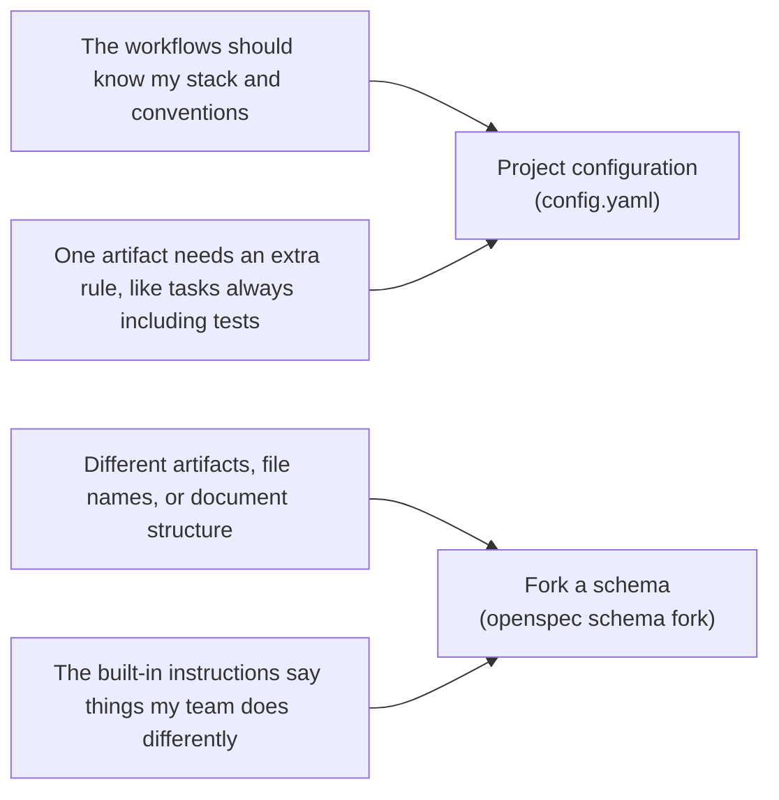

# Обзор

> Варианты настройки OpenSpec.

OpenSpec поддерживает несколько вариантов настройки. На этой странице описано, что изменяет каждый из них и когда его использовать.

## Что можно настроить

| Вариант | Что он изменяет | Когда его использовать |
|---|---|---|
| [Профили](profiles.md) | Какие процессы устанавливаются и в каком виде: как навыки, команды или и то и другое | Вам нужны дополнительные процессы и способы работы или нужно удалить ненужные процессы |
| [Конфигурация проекта](project-config.md) | Инструкции, добавляемые при каждом запуске процесса: контекст, правила и рекомендации по работе (`config.yaml`) | Вы хотите, чтобы изменения планировались по вашим правилам, например чтобы задачи всегда включали тесты Playwright |
| [Схемы](schemas.md) | Что создаёт OpenSpec: артефакты, их порядок и шаблоны | Изменения должны приводить к созданию других файлов планирования, разделов или форматов |

## Не знаете, что выбрать?

Конфигурация и схемы — два уровня настройки. Выбирайте в зависимости от того, насколько глубоко вы хотите вмешиваться:

- **Начните с [конфигурации проекта](project-config.md)**: она проще, и для большинства проектов её достаточно. Вы сохраняете стандартные артефакты и добавляете поверх них собственный контекст и правила.
- **Создайте форк [схемы](schemas.md), если добавлений недостаточно**: конфигурация лишь дополняет базовый процесс. Она позволяет добавить правило вроде «задачи всегда включают тесты», но не позволяет убрать документ дизайна или переименовать файл. Это уже область схем. Создание форка даёт вам собственную копию для редактирования.

*Здесь «форк» означает команду `openspec schema fork`, а не создание форка git-репозитория. Подробности — в разделе [«Схемы»](schemas.md).*

