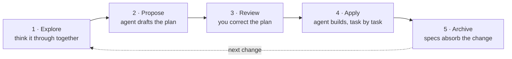

# Быстрый старт

> Ваше первое изменение в новом или существующем проекте — от идеи до архивирования.

Перед началом работы установите CLI на свой компьютер ([Установка](installation.md)) и инициализируйте OpenSpec в проекте ([Настройка проекта](setup.md)).

## Начните с пустого проекта

Вы можете начать, не выбрав стек и не имея законченной архитектуры. Инициализируйте OpenSpec в папке проекта, затем попросите агента вместе с вами изучить возможные варианты. В чате с ИИ:

```text
Help me explore a task tracker from scratch. I have not picked a stack. Compare the options and help me choose the first behavior to build.
```

Определите, что необходимо для первого изменения, и оставьте последующие архитектурные решения открытыми. Попросите агента подготовить предложение только для этого изменения, затем выполните шаги ниже. По мере развития проекта вы сможете пересмотреть архитектуру.

## Краткий обзор цикла

Каждое изменение проходит одни и те же пять шагов. Вы обдумываете идею вместе с агентом, он готовит проект плана, а вы исправляете план до появления кода. Затем агент реализует план, а архивирование обновляет спецификации в соответствии с тем, что было выпущено.



Каждый промпт ниже нужно вводить в чате с ИИ — там же, где вы запрашиваете код. Примеры написаны простым языком, чтобы их можно было использовать в разных инструментах. Вы также можете напрямую вызвать навык; синтаксис зависит от инструмента ([поддерживаемые инструменты](../reference/supported-tools.md)).

## Шаг 1: Исследование

Обдумайте идею вместе с агентом, прежде чем запрашивать план. В чате с ИИ:

```text
Help me explore how rate limiting should work in this app.
```

Исследование — это режим обдумывания. Агент изучает вашу кодовую базу, задаёт важные вопросы, намечает варианты и проверяет исходные допущения. Он никогда не пишет код. Он ничего больше не записывает, если только вы не попросите его зафиксировать принятые решения или не согласитесь, когда он сам это предложит. Результат — более чётко сформулированная идея.

Оставайтесь на этом шаге столько, сколько требуется для проработки задачи. Когда общие контуры решения покажутся вам правильными, передайте задачу дальше:

```text
Propose the change we just discussed.
```

Эта фраза запускает подготовку предложения и передаёт в неё всё, о чём вы договорились. Пропустите первый промпт шага 2.

## Шаг 2: Предложение

Предложение превращает идею в план, который можно проверить. После исследования этот этап уже запущен. Если вы начинаете без предварительного исследования и уже чётко представляете изменение, сразу попросите подготовить предложение. В чате с ИИ:

```text
Propose a change to add rate limiting.
```

Агент задаёт необходимые вопросы, а затем создаёт папку изменения:

```
openspec/changes/add-rate-limiting/
├── proposal.md    why, and what changes
├── specs/         what "done" means, as testable requirements
├── design.md      technical decisions (only when the change needs one)
└── tasks.md       the implementation checklist
```

Кода пока нет. Этап предложения завершается планом.

## Шаг 3: Проверка и исправление плана

Исправьте план, пока он существует только в виде текста и ничего ещё не реализовано. Читайте в следующем порядке:

- **`proposal.md`**: та ли это задача и подходящего ли она масштаба?
- **`specs/`**: самая важная часть проверки. Достаточно ли выполнения этих требований, чтобы считать работу завершённой?
- **`tasks.md`**: покрывают ли задачи спецификации и нет ли в них ничего лишнего?

Чтобы что-то исправить, подойдёт любой из двух способов:

- Отредактируйте файл самостоятельно. Артефакты представляют собой обычный Markdown, а сами файлы являются планом.
- Сообщите агенту, что не так («в спецификации не учтён случай без аутентификации»). Он исправит артефакты.

## Шаг 4: Применение

Применение превращает план в код. Начните новый сеанс чата: с чистым контекстным окном реализация обычно идёт лучше. В чате с ИИ:

```text
Apply the add-rate-limiting change.
```

Агент читает папку изменения, затем выполняет задачи из `tasks.md`, отмечая каждую по мере завершения.

- **Работа прервана или закончился контекст?** Откройте новый сеанс и снова попросите агента применить изменение. Он продолжит с первой неотмеченной задачи.
- **План оказался неверным?** Исправьте артефакты любым способом из шага 3, затем продолжьте применение.
- **Прогресс** отображается в флажках `tasks.md`. Скрытого состояния нет.

## Шаг 5: Архивирование

Архивирование выполняет два действия: обновляет основные спецификации с учётом требований изменения и перемещает папку изменения в папку архива (в `/openspec/changes/archive/*`).

Когда все флажки в `tasks.md` отмечены, введите в чате с ИИ:

```text
Archive the add-rate-limiting change.
```

Ниже пошагово показано, что делает архивирование:

```file-steps
## The finished change
> Implementation is done. The delta spec (what this change adds) still sits inside the change folder; specs/ doesn't know about rate limiting yet.
  openspec/
  ├── specs/                                   (no rate-limiting spec yet)
  └── changes/
      └── add-rate-limiting/
          ├── proposal.md
          ├── tasks.md                         every box checked
          └── specs/
              └── rate-limiting/
                  └── spec.md                  the delta: ADDED requirements

## Requirements land in specs/
> Each requirement in the delta lands in the main spec: added ones append, modified ones replace their old version. A new capability gets a new spec file.
  openspec/
  ├── specs/
+ │   └── rate-limiting/
+ │       └── spec.md                          gains "Requirement: Rate limiting"
  └── changes/
      └── add-rate-limiting/
          └── specs/
              └── rate-limiting/
                  └── spec.md                  the delta, source of the merge

## The folder moves to archive/
> The whole change folder, delta included, moves into the archive under a date prefix. Nothing is deleted.
  openspec/
  ├── specs/
  │   └── rate-limiting/
  │       └── spec.md
  └── changes/
-     └── add-rate-limiting/
+     └── archive/
+         └── 2026-08-08-add-rate-limiting/
+             ├── proposal.md
+             ├── tasks.md
+             └── specs/rate-limiting/spec.md

## Specs describe the system as built
> changes/ is clear for the next change. specs/ is the source of truth for what the system does; archive/ is the history of how it got there.
  openspec/
  ├── specs/
  │   └── rate-limiting/
  │       └── spec.md                          the spec as built
  └── changes/
      └── archive/
          └── 2026-08-08-add-rate-limiting/
```

Git — отдельный вопрос. Создайте коммит с папкой изменения и кодом, и ничего больше в вашем процессе не изменится.

### Сохранение или очистка архивных изменений

В `openspec/changes/archive/` хранятся предложение, дизайн, задачи и дельта каждого завершённого изменения. В описанном выше процессе архивирования дельта уже обновила `openspec/specs/`.

- **Сохраните всю папку изменения**, если нужно, чтобы текущая рабочая копия содержала всю информацию об изменении.
- **Удалите папку `specs/` заархивированного изменения**, если история спецификаций ведётся в Git. Сначала создайте коммит с архивом, затем удалите `openspec/changes/archive/<change>/specs/`. Предложение, дизайн и задачи останутся в рабочей копии. `openspec validate --archived` продолжит работать, поскольку команда проверяет завершение задач, а не применённые дельты.
- **Удалите всю папку изменения**, только если её предложение, дизайн и история задач больше не нужны в рабочей копии. Текущие спецификации не изменятся, но `openspec validate --archived` и поиск по рабочей копии больше не будут учитывать это изменение.

> [!WARNING]
> Сохраните коммит архивирования в истории репозитория, если хотите, чтобы Git сохранил удалённые файлы. Если объединить коммит архивирования и коммит очистки в один, этот промежуточный снимок будет удалён.

OpenSpec не удаляет архивные изменения автоматически и не предоставляет настройку срока хранения.

## Что дальше

- [Дельта-спецификации](../reference/schemas/spec-driven/index.md#delta-specs-specmd): как описывать изменения поведения в дельта-спецификации.
- [Профили](../customize/profiles.md): необязательные процессы в дополнение к основному набору (проверка перед архивированием, инкрементальное планирование).

## Продвинутые руководства

<!-- Planned pages, not yet written or in the README page map. Listed here so the quickstart routes to them once they exist. -->

Планируется добавить следующие руководства (они ещё не написаны):

- **Сначала прототип**: напишите пробный код до создания каких-либо спецификаций, а затем подготовьте предложение на основе выводов, сделанных благодаря прототипу.
- **Итеративная разработка**: последовательность небольших изменений вместо одного большого предложения.
- **Пересмотр реализованного изменения**: после применения план снова нужно изменить, но изменение ещё не влито и не заархивировано.
