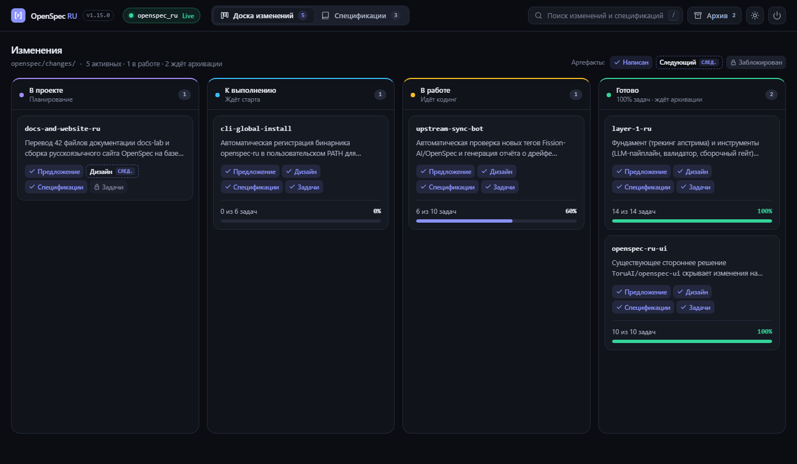
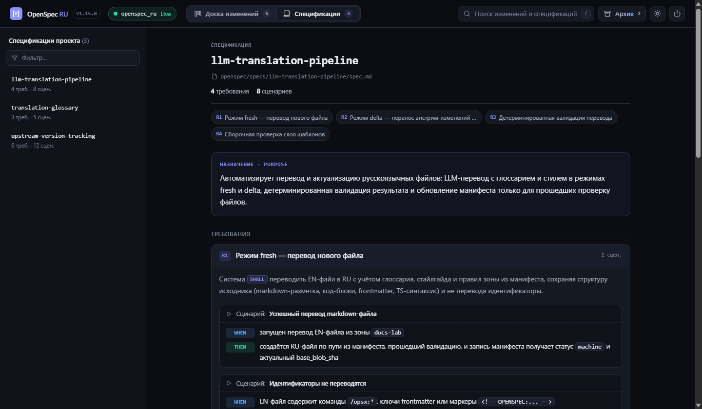

# OpenSpec RU

> Русская версия OpenSpec со встроенной веб-панелью спецификаций и Канбан-доской изменений, переведённой документацией, шаблонами артефактов и патчером для ИИ-инструментов. Неофициальный проект русскоязычного сообщества, не продукт Fission-AI.

> [!NOTE]
> Это неофициальный перевод, привязанный к OpenSpec **1.16.0** ([OnePro/openspec_ru](https://github.com/OnePro/openspec_ru)). Перевод официальной документации OpenSpec — [в остальных разделах сайта](/docs/installation).

## Встроенная веб-панель изменений и спецификаций

В `openspec-ru` встроена локальная веб-панель для визуального контроля проекта: **Канбан-доска всех изменений** (от черновика до архива) и **читальня основных спецификаций** с мгновенным обновлением в реальном времени (SSE).





### Как открыть веб-панель

**Через ИИ-ассистента (скилл `openspec-ui` устанавливается автоматически):**

Напишите агенту в чате:

> **«открой спеки»** / **«открой панель со спецификациями»** / **«покажи доску изменений»**
> *(или вызовите `/opsx:ui` / `/openspec-ui`)*

Агент запустит сервер в фоновом режиме (`--detach`) и пришлёт ссылку. Чтобы остановить сервер, напишите агенту **«закрой спеки»**.

**Из терминала:**

```bash
# Запустить веб-панель (по умолчанию порт 3000; если занят — 3001..3015)
openspec-ru start web
openspec-ru start web --port 3000

# Запустить в фоновом режиме
openspec-ru start web --detach

# Остановить фоновый сервер
openspec-ru stop web
```

## Что входит в openspec_ru

**openspec_ru** — русскоязычный перевод [OpenSpec](https://github.com/Fission-AI/OpenSpec): системы согласования изменений с ИИ-ассистентом через спецификации.

- Встроенная веб-панель спецификаций и Канбан-доска изменений (`openspec-ru start web` и скилл `openspec-ui`).
- Перевод документации OpenSpec на русский язык (все разделы этого сайта).
- Перевод шаблонов артефактов (`proposal.md`, `design.md`, `tasks.md`, `spec.md`) и slash-команд `/opsx:*`.
- Патчер для 44 ИИ-инструментов: Claude Code, Cursor, GitHub Copilot, Codex, Gemini и [других](/docs/supported-tools).

## Установить за 4 шага

Если OpenSpec ещё не установлен — выполните настройку за пару минут:

1. Подготовьте git-репозиторий проекта.
2. Установите CLI OpenSpec на компьютер.
3. Выполните `npx --yes github:OnePro/openspec_ru#v1.16.0 init` в корне проекта.
4. Проверьте, что русские артефакты и скилл `openspec-ui` на месте.

**[Точная последовательность команд →](/docs/ru/install)**

## Что дальше

- [Установка и обновление openspec-ru](/docs/ru/install) — все команды в одном блоке и пошаговая проверка.
- [Шаблоны артефактов](/docs/ru/templates/proposal) — как выглядят `proposal.md`, `design.md`, `tasks.md`, `spec.md` на русском.
- [Документация OpenSpec](/docs/installation) — перевод официальных страниц: концепции, настройка, справочник CLI.

## Как предложить правку

Замечания по переводу и веб-панели оформляйте issue или pull request в [OnePro/openspec_ru](https://github.com/OnePro/openspec_ru). Ошибки самого OpenSpec сообщайте в апстрим [Fission-AI/OpenSpec](https://github.com/Fission-AI/OpenSpec).
